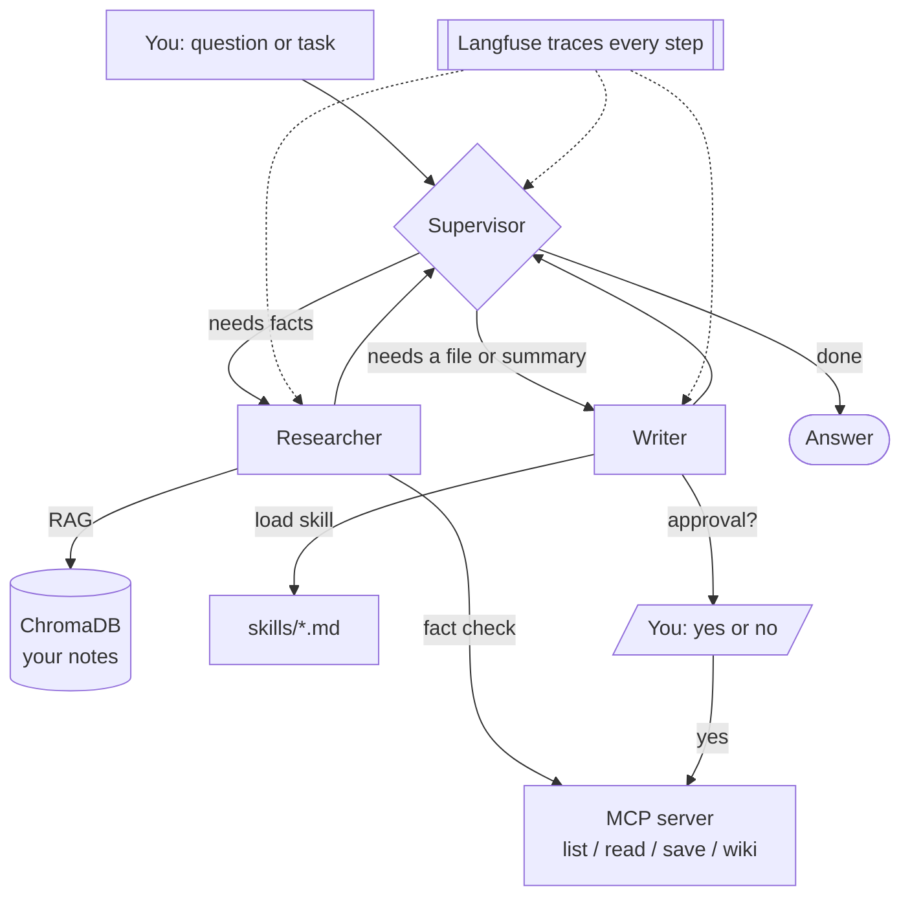
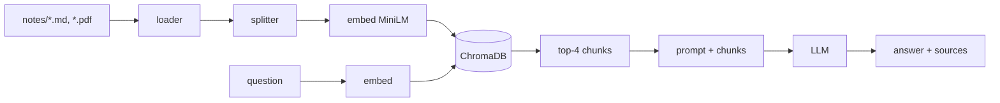
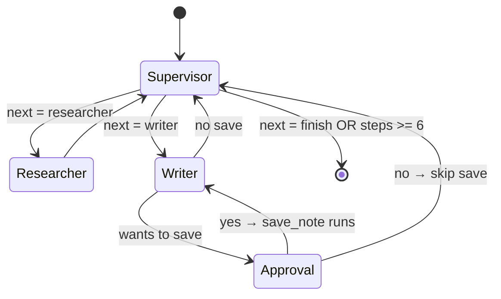

# DocuMind — Design (v0.1, draft)

> SDLC stage 2 of 6: Requirements ✅ → **Design** → Build → Test → Evaluate → Release
> Based on [REQUIREMENTS.md](REQUIREMENTS.md) (approved 2026-11-14).
> Status: **Draft — waiting for your approval.**

**Defaults for the two open questions in the requirements:**
- **Wikipedia fact check:** in v1. It's one small tool and it gives the Researcher a second source.
- **PDFs:** supported from Phase 1 via `pypdf`. It adds about 5 lines of code.

Tell me if you'd rather change either.

---

## 1. Big picture



Each phase adds one layer to this picture:

| Phase | What exists after it |
|---|---|
| 0 | Plain LLM calls, a LangChain chain, embeddings demo |
| 1 | Notes → ChromaDB → answers with citations, traced in Langfuse |
| 2 | MCP server with tools, skills, and one tool-using agent |
| 3 | The full graph above, with memory and human approval |
| 4 | Eval scripts scoring all of it |

---

## 2. Folder layout

```text
documind/
├── pyproject.toml            # uv project and dependencies
├── .env.example              # GROQ_API_KEY=, LANGFUSE_* names only
├── .gitignore                # .env, .chroma/, notes/mine/, notes/output/
├── README.md                 # how to run each phase
├── docs/                     # REQUIREMENTS.md, DESIGN.md
│
├── documind/                 # the Python package
│   ├── config.py             # settings from .env (model, paths, top_k...)
│   ├── llm.py                # get_llm(): ONE place that creates the LLM
│   ├── tracing.py            # get_langfuse_handler()
│   │
│   ├── phase0_basics/        # standalone demos, run one by one
│   │   ├── d1_first_call.py
│   │   ├── d2_temperature.py
│   │   ├── d3_streaming.py
│   │   ├── d4_structured.py
│   │   ├── d5_lcel_chain.py
│   │   └── d6_embeddings.py
│   │
│   ├── rag/                  # Phase 1
│   │   ├── loader.py         # read .md / .pdf → Documents
│   │   ├── splitter.py       # chunk by heading, then by size
│   │   ├── store.py          # ChromaDB: index (only changed files), search
│   │   └── qa.py             # retrieve → prompt → answer with citations
│   │
│   ├── mcp_server/           # Phase 2
│   │   ├── server.py         # FastMCP: list_notes, read_note, save_note, wiki_search
│   │   └── safe_paths.py     # blocks ../ and absolute paths
│   ├── skills/               # Phase 2
│   │   └── loader.py         # lists skills; loads full text on demand
│   ├── agent_single.py       # Phase 2: one agent with MCP tools + skills
│   │
│   ├── graph/                # Phase 3
│   │   ├── state.py          # DocuState (shared state)
│   │   ├── supervisor.py
│   │   ├── researcher.py
│   │   ├── writer.py
│   │   └── build.py          # wires nodes, edges, checkpointer, interrupt
│   └── cli.py                # `python -m documind.cli` chat loop
│
├── skills/                   # skill files (content, not code)
│   ├── flashcards/SKILL.md
│   └── summary/SKILL.md
│
├── notes/
│   ├── samples/              # 4 sample notes (committed, used by tests)
│   ├── mine/                 # your own files (git-ignored)
│   └── output/               # agent-written files (git-ignored)
│
├── evals/                    # Phase 4
│   ├── dataset.json
│   ├── ragas_eval.py
│   ├── agent_eval.py
│   ├── run.py                # python -m evals.run
│   └── results/
│
└── tests/                    # pytest, one file per module
```

**Why this layout:** Phase 0 demos are throwaway scripts, kept separate so they stay simple. Everything from Phase 1 on is a real package, because later phases reuse earlier code: the Researcher reuses `rag/qa.py`, and the Writer reuses the MCP tools.

---

## 3. Shared building blocks

### 3.1 `config.py`
A single Pydantic `Settings` class that reads `.env`.

| Setting | Default |
|---|---|
| `llm_provider` | `groq` |
| `llm_model` | a Groq Llama model with tool calling (exact name confirmed in Phase 0 against Groq's current model list) |
| `embed_model` | `sentence-transformers/all-MiniLM-L6-v2` |
| `chroma_dir` | `.chroma/` |
| `notes_dir` | `notes/` |
| `top_k` | `4` |
| `max_graph_steps` | `6` |

### 3.2 `llm.py`
`get_llm(temperature=0)` is the **only** place that creates a chat model. Switching to Gemini or Ollama later is a change here, not in every file (NFR7). It also wraps calls with retry and backoff for Groq rate limits (NFR6).

### 3.3 `tracing.py`
`get_langfuse_handler()` returns a Langfuse LangChain callback handler, or `None` if the Langfuse keys are missing. Missing keys mean the app still works, just without traces, so tests never need Langfuse.

---

## 4. Phase 1: RAG design



| Decision | Choice | Why |
|---|---|---|
| Chunking | Split on markdown headings first, then about 800 characters with 100 overlap | Heading-sized chunks keep one idea together, and the heading becomes the citation |
| Chunk metadata | `source` (file), `heading`, `chunk_id`, `file_hash` | Citations, plus re-indexing only changed files |
| Re-index | Compare each file's hash with the stored hash; delete and re-add only changed files | FR1.4. Saves time as notes grow |
| Retrieval | Pure vector search, top_k=4 | Simple first. Hybrid search (BM25) is an exercise idea, as you built it in ai-job-search |
| "Not found" | If the best similarity is below a threshold, **or** the LLM says the context doesn't contain the answer → "Not found in your notes" | FR1.6. Two guards, since either alone can miss |
| Answer format | Answer text, then `Sources: file › heading` | US1 |

**Prompt rule:** "Answer ONLY from the context. If the context does not contain the answer, say NOT_FOUND."

---

## 5. Phase 2: MCP + Skills design

### 5.1 MCP tools

| Tool | Input | Output | Safety rule |
|---|---|---|---|
| `list_notes()` | none | list of note file names | read-only |
| `read_note(name)` | file name | file text (capped at 20k characters) | must resolve inside `notes/` |
| `save_note(name, text, overwrite=False)` | `.md` file name + text | saved path | only inside `notes/output/`, only `.md`, no overwrite unless asked |
| `wiki_search(query)` | text | top 3 Wikipedia summaries + URLs | read-only, 10-second timeout |

`safe_paths.resolve_inside(base, name)` resolves the full path and rejects it if the result isn't under `base`. This blocks `../`, absolute paths and drive letters like `C:\`. Tests cover each attack.

**Transport:** stdio, so the client starts the server as a subprocess. That's the simplest option, and it's what Claude Desktop uses.

**Client:** `langchain-mcp-adapters` turns MCP tools into LangChain tools, so agents use them like any other tool.

### 5.2 Skills

Each skill is a folder with a `SKILL.md`:

```markdown
---
name: flashcards
description: Turn notes into Q&A flashcards. Use when the user asks for flashcards, quiz cards or revision cards.
---
# Flashcard rules
- 8–12 cards, one fact per card
- Format:  **Q:** ...  /  **A:** ...
- ...
```

**Progressive loading (FR2.7):**
1. At startup the agent's system prompt gets only the list of `name: description` pairs. This is short and cheap.
2. The agent calls the `load_skill(name)` tool when it decides a skill fits.
3. Only then does the full skill text enter the conversation.

**Why:** this is the core idea of Agent Skills. Many skills can exist without filling the prompt.

---

## 6. Phase 3: LangGraph design

### 6.1 Shared state

```python
class DocuState(TypedDict):
    messages: Annotated[list, add_messages]   # chat history (memory)
    task: str                                 # the user's request
    next: Literal["researcher", "writer", "finish"]
    research: list[dict]                      # chunks + wiki results with sources
    draft: str                                # writer's output text
    files_written: list[str]
    steps: int                                # loop guard counter
```

### 6.2 Nodes

| Node | Job | Uses |
|---|---|---|
| **Supervisor** | Reads the state and picks `next` using structured output (`{next, reason}`) | LLM only, no tools |
| **Researcher** | Fills `research` | `rag/qa.py` retrieval + `wiki_search` |
| **Writer** | Writes `draft`, optionally saves it | `load_skill`, `save_note` |
| **Approval** | Pauses before `save_note` using LangGraph's `interrupt()`, then resumes on yes or no | none |

### 6.3 Routing rules



- **Plain question:** Supervisor → Researcher → Supervisor → finish (answer from research)
- **Flashcards + save:** Supervisor → Researcher → Supervisor → Writer → Approval → Writer → Supervisor → finish

### 6.4 Memory
An `InMemorySaver` checkpointer keyed by `thread_id`. "Make it shorter" works because the earlier messages and `draft` are in the saved state. It's in-memory because SQLite or Postgres persistence isn't needed for learning (it's an easy upgrade).

### 6.5 Langfuse
One trace per user request, with the node name on each span, so the Langfuse tree reads as Supervisor → Researcher → retriever → LLM, and so on (FR3.8).

---

## 7. Phase 4: Evaluation design

### 7.1 `evals/dataset.json` item
```json
{
  "id": "q01",
  "question": "What does backpropagation compute?",
  "reference_answer": "Gradients of the loss with respect to each weight...",
  "expected_sources": ["neural_networks.md"],
  "expected_route": ["researcher"],
  "expected_tools": [],
  "type": "qa"
}
```
There are 10 items: 6 Q&A, 2 not-in-notes, and 2 save tasks (flashcards, summary).

### 7.2 What gets measured

| Eval | Tool | Metric | Target |
|---|---|---|---|
| Retrieval + answer | RAGAS | faithfulness, answer relevancy, context precision, context recall | faithfulness ≥ 0.8 |
| Routing | custom (exact match) | Supervisor's route vs `expected_route` | ≥ 80% |
| Tool use | custom / DeepEval | right tools, right order, no tools for plain Q&A | ≥ 80% |
| Not-found | custom | answers NOT_FOUND on the 2 trick questions | 2/2 |
| Answer quality | DeepEval (LLM-as-judge, Groq as judge) | correctness vs `reference_answer` | report only |

**For save tasks, approval is auto-yes in evals**, by resuming the interrupt with `yes` programmatically.

**Judge LLM:** RAGAS and DeepEval need an LLM as the judge. Both use the same Groq model via `get_llm()`. Evals run one at a time to stay within free-tier limits.

---

## 8. Test plan

| Layer | What | LLM? | Runs |
|---|---|---|---|
| Unit | config, loader, splitter, hashing/re-index, safe_paths, skill loader, routing logic | **Fake LLM** (LangChain `FakeListChatModel`) | always: offline, free, fast |
| Integration | MCP server called through a real MCP client; full graph with the fake LLM; interrupt/resume | Fake | always |
| Live | One real Groq call per phase | Real | opt-in: `pytest -m live` |
| Evals | Phase 4 scripts | Real | manual: `python -m evals.run` |

**Rule (from your working rules):** each phase ships with its tests, and all tests pass before the next phase starts.

---

## 9. Dependencies (added per phase, not all at once)

| Phase | Packages |
|---|---|
| 0 | `langchain`, `langchain-groq`, `pydantic-settings`, `python-dotenv`, `sentence-transformers` |
| 1 | `langchain-chroma`, `chromadb`, `langchain-text-splitters`, `pypdf`, `langfuse` |
| 2 | `fastmcp`, `langchain-mcp-adapters`, `httpx` |
| 3 | `langgraph` |
| 4 | `ragas`, `deepeval` |
| 5 | `streamlit` |
| dev | `pytest`, `pytest-asyncio` |

**Why add per phase:** you see what each topic needs, and installs stay small early on.

---

## 10. Risks

| Risk | What we do |
|---|---|
| Groq free-tier rate limits | Retry with backoff, sequential evals, small dataset |
| Small Llama models make messy tool calls | Supervisor uses structured output; max-steps guard; tests with a fake LLM |
| RAGAS/DeepEval versions change their APIs often | Pin versions in `pyproject.toml` |
| First run downloads the MiniLM model (~90 MB) | Mentioned in the README; it's cached after that |
| Langfuse Cloud sends trace data off your PC | Use only sample or non-private notes while tracing, or turn tracing off by removing the keys |

---

## 11. Build order (next SDLC stage)

1. **Phase 0:** project skeleton (`uv`, config, llm.py, .env.example, .gitignore) + 6 demos + tests
2. **Phase 1:** sample notes + RAG + Langfuse
3. **Phase 2:** MCP server + skills + single agent
4. **Phase 3:** LangGraph multi-agent
5. **Phase 4:** evals
6. **Phase 5:** optional UI

You run each phase and understand it before we start the next.
